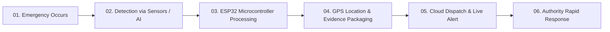

# 🛡️ SmartSuraksha (स्मार्ट सुरक्षा)
### Next-Gen AI & IoT Street Safety Network for Safer Cities

[](https://github.com/RishiHuyr/cgc_hackathon)
[](https://reactjs.org/)
[](https://www.typescriptlang.org/)
[](https://tailwindcss.com/)
[](https://www.espressif.com/)

---

## 📌 Overview

**SmartSuraksha** transforms traditional street poles and streetlights into intelligent, multi-layered emergency safety nodes. Equipped with computer vision, ambient hazard sensors, emergency SOS buttons, and high-precision GPS, SmartSuraksha automatically detects road incidents, alerts emergency response authorities within seconds, and provides real-time situational evidence to save lives.

---

## 🚀 Key Features

| Feature | Description | Tech Used |
| :--- | :--- | :--- |
| **01. CCTV Camera Surveillance** | 360° street monitoring, incident video recording, and real-time visual feed during alerts. | IP Camera / ESP32-CAM |
| **02. Fire & Flame Detection** | Optical flame sensors & thermal detection to trigger immediate fire alerts to fire departments. | Flame & Smoke Sensors |
| **03. Women Safety SOS** | Pole-mounted physical emergency button allowing individuals in danger to instantly broadcast alerts. | Tactile SOS Buttons + GPS |
| **04. Smart Accident Detection** | Impact detection and audio-visual incident verification to dispatch ambulances instantly. | Accelerometers & AI Vision |

---

## 🔄 How SmartSuraksha Works (Workflow)



1. **Emergency Occurs** — Accident, fire outbreak, or women safety SOS trigger.
2. **Detection** — Flame sensors, impact sensors, or AI vision detect the anomaly.
3. **ESP32 Processing** — The on-pole microcontroller processes the event in real-time (<2s).
4. **Location & Evidence** — Coordinates from GPS and CCTV footage are attached to the incident report.
5. **Firebase & Live Dashboard** — High-priority payload is pushed to cloud and displayed on authority screens.
6. **Emergency Response** — Police, ambulances, or fire services are dispatched with exact coordinates.

---

## 👥 The Minds Behind SmartSuraksha

- **Aditya** — *Backend Developer*  
  Building backend architecture, database integration, and real-time emergency data pipelines.
- **Rishi** — *Frontend Developer*  
  Designing the UI/UX and building the intuitive, responsive authority command dashboard.
- **Piyush** — *IoT Developer*  
  ESP32 microcontroller integration, hardware sensors, and embedded communication systems.
- **Kanika** — *Research & Development*  
  Researching street safety solutions, emergency protocols, and innovative hardware approaches.

---

## 🛠️ Tech Stack

- **Frontend:** React 18, TypeScript, Tailwind CSS, Lucide Icons, Shadcn UI
- **Animations:** Custom CSS3 & SVG Neon Glow Effects
- **Hardware / IoT:** ESP32, Flame Sensors, Accelerometers, GPS Modules, SOS Switch
- **Cloud & Real-time:** Firebase Cloud Messaging & Realtime Database

---

## 💻 Local Development Setup

To run this project locally:

```bash
# 1. Clone the repository
git clone https://github.com/RishiHuyr/cgc_hackathon.git

# 2. Navigate to project directory
cd cgc_hackathon

# 3. Install dependencies
npm install

# 4. Start the development server
npm run dev
```

Open [http://localhost:8080](http://localhost:8080) to view it in your browser.

---

## 📄 License
This project is built for the **CGC Hackathon**. All rights reserved.
